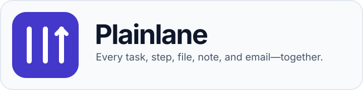
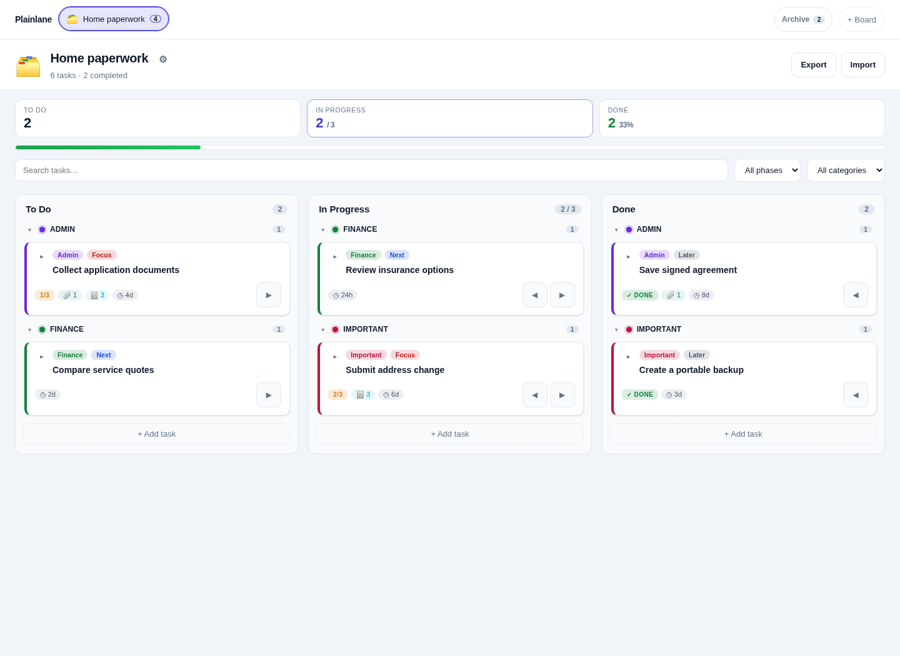

<p align="center">
  
</p>

<p align="center"><strong>A small, self-hosted Kanban that keeps the task and its evidence together.</strong></p>

Plainlane gives you three lanes—**To Do**, **In Progress**, and **Done**—plus the context needed to finish the work. Comments, forms, saved emails, documents, and optional web research all stay attached to the card in one mounted SQLite database.

No accounts. No due dates. No notification machine.

## Why Plainlane?

Most tiny Kanban boards track the task while its useful context lives elsewhere. Plainlane's difference is simple:

> **The card is the workspace.** The task, conversation, files, evidence, and researched sources move together.

That makes Plainlane useful for personal administration, applications, purchases, home projects, research, and any process where finishing a task means keeping documents and decisions close at hand.

## Start in one command

You need [Docker](https://docs.docker.com/get-docker/) with Docker Compose v2.

```bash
git clone https://github.com/RainerGewalt/plainlane.git
cd plainlane
./start.sh
```

Open [http://localhost:8080](http://localhost:8080). The start script also prints a LAN address for your phone or another computer.

<p align="center">
  
</p>

## What you get

- Browser-managed boards and cards
- Drag and drop plus keyboard-accessible move buttons
- Inline card expansion for details and subtasks
- Move undo and a guard against completing cards with open subtasks
- Optional time-in-column hints on cards
- An optional per-board limit for main tasks in **In Progress**
- Search and lightweight category/phase filters
- Comments and notes on every card
- PDF, email, image, Office, and text attachments up to 15 MB
- A status and note for every attachment
- Full board import/export, including file contents
- Optional OpenAI web research with saved source links
- NGINX for desktop, tablet, and phone access
- One mounted SQLite database—no external database service

Plainlane deliberately stops there. It has no accounts, roles, due dates, notifications, mailbox sync, or automation engine.

## Optional AI research

Add an API key to the local `.env` file and restart Plainlane:

```dotenv
OPENAI_API_KEY=your-key-here
```

Move a card to **In Progress** and open it to start research. Plainlane sends only the board name, card title, card details, and your question to OpenAI. Attachments, comments, other cards, and the database are not sent. Results and clickable sources are saved on the card.

AI usage may cost money. Verify important information at the linked original source.

## Data and access

The complete state lives in `/data/plainlane.db` inside the Docker volume. Use **Export** in the browser for a portable board backup. Exports include attachment contents, so treat them as sensitive files.

Each card also exposes `statusChangedAt` through the local API and JSON export. Plainlane updates this timestamp only when the main card changes lane; it powers the optional time-in-column hint. Board responses expose `progress_limit` (`null` means unlimited) and `show_lane_age` (`0` or `1`) for the corresponding board options.

Plainlane has **no login screen**. Anyone who can reach its port can use the app and access its files. Keep it on a trusted network, bind it to localhost, or place it behind an authenticated reverse proxy. Do not expose port 8080 directly to the internet.

See [SECURITY.md](SECURITY.md) for the deployment model.

## Configuration

`start.sh` creates `.env` from the safe example automatically.

| Variable | Default | Purpose |
| --- | --- | --- |
| `PLAINLANE_PORT` | `8080` | NGINX browser port |
| `OPENAI_API_KEY` | empty | Enables optional research |
| `OPENAI_MODEL` | `gpt-5.6` | Research model |

The default setup uses a Docker volume. To see the database in a local `data/` directory, use [the bind-mount example](examples/compose.bind-mount.yml):

```bash
mkdir -p data
docker compose -f compose.yml -f examples/compose.bind-mount.yml up --build -d
```

## Useful commands

```bash
./start.sh status
./start.sh logs
./start.sh restart
./start.sh stop
```

For local development:

```bash
npm install
cp .env.example .env
npm run dev
```

Coding-agent boundaries are in [AGENTS.md](AGENTS.md). See [CONTRIBUTING.md](CONTRIBUTING.md) to contribute.

## License

[MIT](LICENSE)
