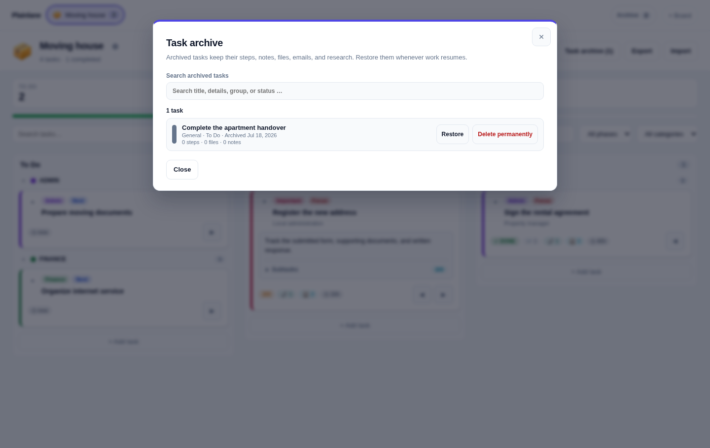
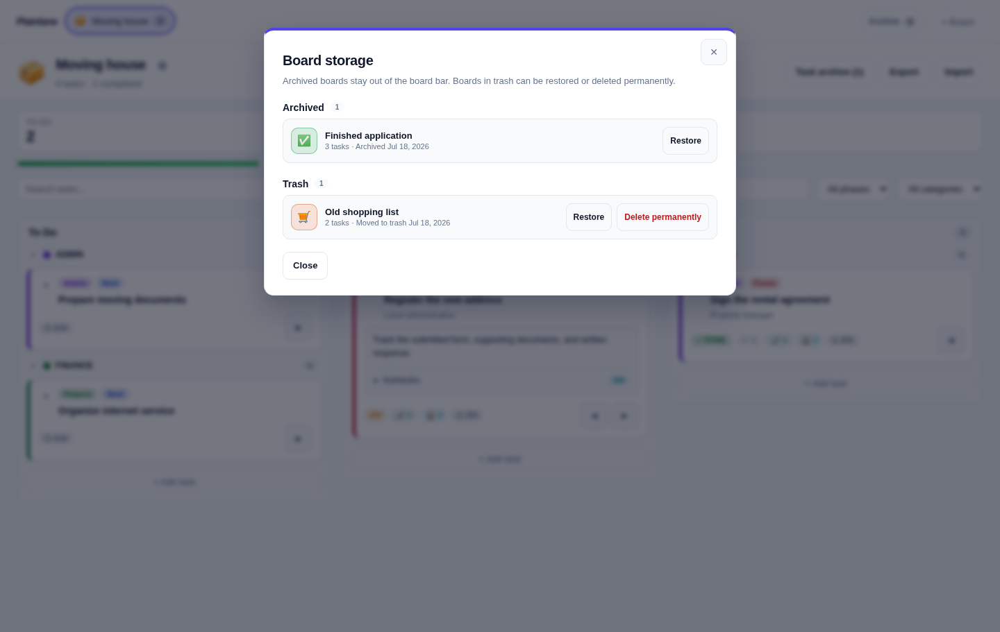

<p align="center">
  
</p>

<p align="center"><strong>Simple task management for everyday projects.</strong></p>

Organize moves, applications, paperwork, purchases, and home projects. **Keep every task, step, file, note, and email together.**

Plainlane is a small self-hosted task board with three lanes—**To Do**, **In Progress**, and **Done**. Steps, comments, saved emails, documents, and optional web research stay attached to the task in one SQLite database.

**Three lanes. One command. No project-management overhead.**

## Why Plainlane?

Plainlane is built for tasks where the card is only the start: a form to submit, documents to collect, an email to save, a response to track, and several small steps to finish.

> **Other boards manage tasks. Plainlane helps you finish tasks with context.**

It fits moves, applications, paperwork, purchases, claims, renovations, and other personal projects with supporting material. It is designed for an individual or household that wants to own its data without administering a full project-management system.

Plainlane is deliberately not a team platform. It has no accounts, roles, calendars, due dates, notifications, mailbox sync, or automation engine.

## Start in one command

You need [Docker](https://docs.docker.com/get-docker/) with Docker Compose v2.

```bash
git clone https://github.com/RainerGewalt/plainlane.git
cd plainlane
./start.sh
```

Open [http://localhost:8080](http://localhost:8080). Plainlane is reachable only from this computer by default.

<p align="center">
  
</p>

## What you get

- Boards and tasks you manage in your browser
- A searchable task archive with restore and undo
- Reversible board archive and trash, with permanent deletion kept in trash
- Drag and drop plus keyboard-accessible move buttons
- Inline card expansion for details and subtasks
- Move undo and a guard against completing cards with open subtasks
- Optional time-in-column hints on cards
- An optional per-board limit for main tasks in **In Progress**
- Search, groups, and lightweight filters
- Comments and notes on every card
- PDF, email, image, Office, and text attachments up to 15 MB
- A status and note for every attachment
- Complete board import/export, including attached files
- Optional OpenAI web research with saved source links
- NGINX for desktop, tablet, and phone access
- One mounted SQLite database—no external database service

Plainlane deliberately stops there. It has no accounts, roles, due dates, notifications, mailbox sync, or automation engine.

## Keep completed work without clutter

Archive a task from its card and restore it from the searchable **Task archive**. Its steps, notes, files, emails, and research remain intact. Archive boards you want out of the board bar, or move them to trash with an immediate **Undo** option. Permanent deletion is available only from an archive or trash and always asks for confirmation.

<p align="center">
  
</p>

<p align="center">
  
</p>

## Try a complete example

Create a fresh board, choose **Import**, and select one of these fictional examples:

- [Moving house](examples/boards/moving-house.json)
- [Job application](examples/boards/job-application.json)

The moving example includes steps, a note, a saved email, and sample file statuses. Import replaces the cards on the selected board only after an explicit confirmation.

## Backup, restore, and update

Plainlane creates a consistent SQLite backup before startup migrations and keeps the latest ten files in `/data/backups`.

```bash
./start.sh backup          # create a backup now
./start.sh backups         # list available backups
./start.sh restore         # restore the newest backup after confirmation
./start.sh restore FILE    # restore a specific listed backup
./start.sh update          # backup, fast-forward, rebuild, and restart
```

Every restore creates another safety backup first. The database file is replaced only after the selected backup has been copied successfully. For unattended restore testing, set `PLAINLANE_CONFIRM_RESTORE=1`; interactive confirmation is the normal default.

## Optional AI research

Add an API key to the local `.env` file and restart Plainlane:

```dotenv
OPENAI_API_KEY=your-key-here
```

Move a card to **In Progress** and open it to start research. Plainlane sends only the board name, card title, card details, and your question to OpenAI. Attachments, comments, other cards, and the database are not sent. Results and clickable sources are saved on the card.

AI usage may cost money. Verify important information at the linked original source.

## Data and access

The complete state lives in `/data/plainlane.db` inside the Docker volume. Use **Export** in the browser for a complete board backup you can move elsewhere. Exports include attached files, so treat them as sensitive.

Each task also exposes `statusChangedAt` through the local API and JSON export. Plainlane updates this timestamp only when the main task changes lane; it powers the optional time-in-column hint. Board responses expose `progress_limit` (`null` means unlimited) and `show_lane_age` (`0` or `1`) for the corresponding board options. Tasks use the additive `archived_at` field. Archived and trashed boards use `archived_at` and `deleted_at`; all remain in the same database until explicitly deleted.

Plainlane has **no login screen**. The default `127.0.0.1` binding therefore exposes it only to the computer running Docker. To use it on a trusted home network, deliberately set `PLAINLANE_BIND_ADDRESS=0.0.0.0`. Do not expose Plainlane directly to the internet; use a VPN or authenticated reverse proxy instead.

See [SECURITY.md](SECURITY.md) for the deployment model.

## Configuration

`start.sh` creates `.env` from the safe example automatically.

| Variable | Default | Purpose |
| --- | --- | --- |
| `PLAINLANE_PORT` | `8080` | NGINX browser port |
| `PLAINLANE_BIND_ADDRESS` | `127.0.0.1` | Browser bind address; use `0.0.0.0` only for a trusted LAN |
| `PLAINLANE_AUTO_BACKUP` | `1` | Creates a rolling backup before startup migrations |
| `OPENAI_API_KEY` | empty | Enables optional research |
| `OPENAI_MODEL` | `gpt-5.6` | Research model |

The default setup uses a Docker volume. To see the database in a local `data/` directory, use [the bind-mount example](examples/compose.bind-mount.yml):

```bash
mkdir -p data
docker compose -f compose.yml -f examples/compose.bind-mount.yml up --build -d
```

## Useful commands

```bash
./start.sh status
./start.sh logs
./start.sh restart
./start.sh backup
./start.sh backups
./start.sh restore
./start.sh update
./start.sh stop
```

For local development:

```bash
npm install
cp .env.example .env
npm run dev
```

Coding-agent boundaries are in [AGENTS.md](AGENTS.md). See [CONTRIBUTING.md](CONTRIBUTING.md) to contribute.

## License

[MIT](LICENSE)
